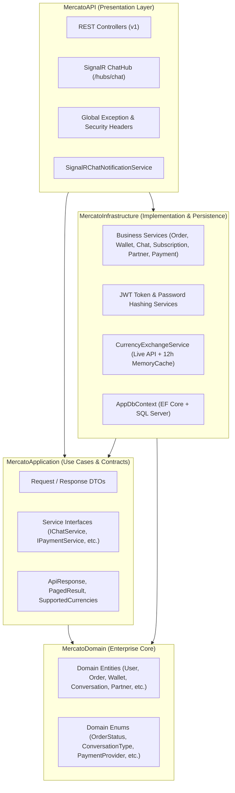
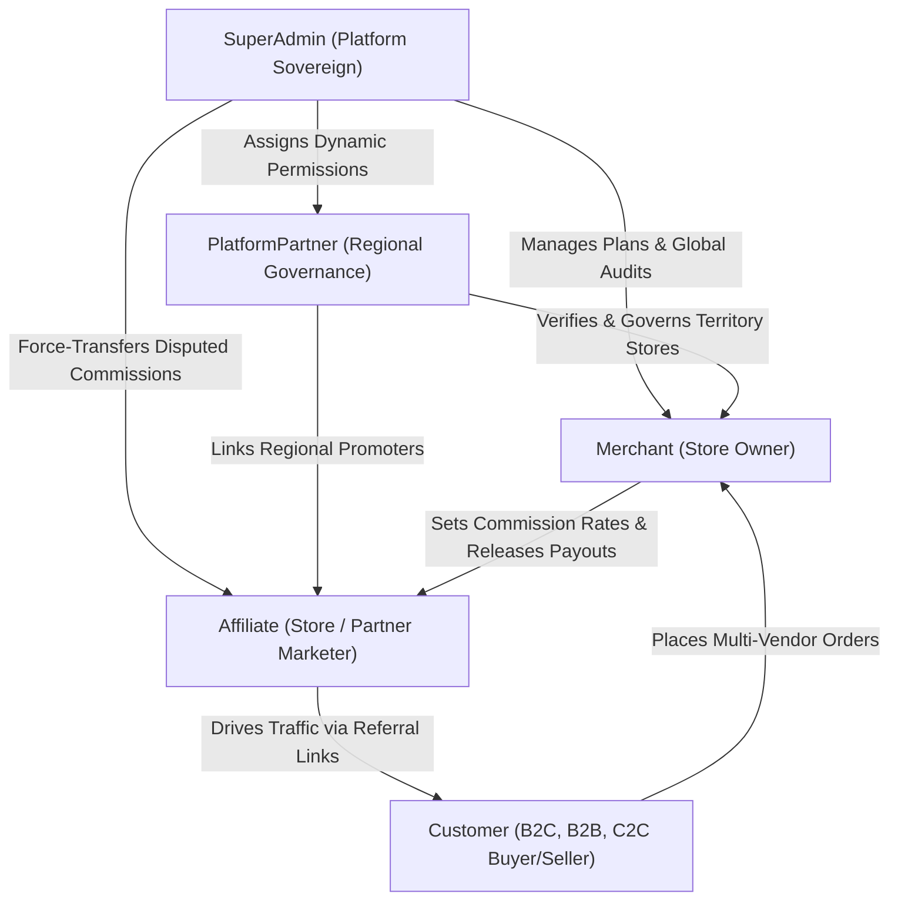
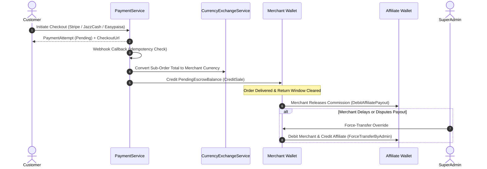
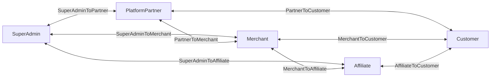

# Mercato Enterprise Marketplace - Backend API

Mercato is an enterprise-grade, multi-vendor, multi-tenant e-commerce marketplace backend built on **.NET 10** and **Clean Architecture**. It supports **B2C**, **B2B Wholesale (tiered bulk pricing & MOQ)**, and **C2C Pre-Owned** business models with dual monetization (monthly subscriptions + per-sale commissions), a double-entry multi-currency escrow wallet, two-tier affiliate marketing, dynamic partner governance, and real-time SignalR messaging.

---

## Table of Contents

1. [System Architecture](#system-architecture)
2. [Role Hierarchy & Authority Matrix](#role-hierarchy--authority-matrix)
3. [Core Enterprise Engines](#core-enterprise-engines)
4. [Financial & Escrow Flow](#financial--escrow-flow)
5. [Real-Time Chat Communication Matrix](#real-time-chat-communication-matrix)
6. [API Endpoints Reference](#api-endpoints-reference)
7. [Technology Stack](#technology-stack)
8. [Local Setup & Running](#local-setup--running)

---

## System Architecture

The solution follows strict **Clean Architecture** principles across four decoupled layers:



### Layer Responsibilities
- **MercatoDomain**: Zero external dependencies. Contains all enterprise entities, domain enums, and core business rules.
- **MercatoApplication**: Defines service contracts (`Interfaces`), request/response `DTOs`, pagination wrappers, and currency constants.
- **MercatoInfrastructure**: Implements business logic, Entity Framework Core `AppDbContext`, SQL Server migrations, external Forex HTTP client integration, and JWT authentication.
- **MercatoAPI**: Exposes versioned REST endpoints (`/api/v1/*`), SignalR WebSocket hubs (`/hubs/chat`), rate limiting, Serilog logging, CORS policies, and Scalar OpenAPI documentation.

---

## Role Hierarchy & Authority Matrix

Mercato operates with five distinct marketplace personas:



1. **SuperAdmin**: Full platform governance, subscription plan management, partner onboarding with dynamic permissions, and force-transfer commission override.
2. **PlatformPartner**: Regional franchise/territory manager. Capabilities are not hardcoded; every action (e.g., `CanVerifyMerchants`) is dynamically validated against the `PartnerPermissions` table.
3. **Merchant**: Multi-model seller operating B2C retail or B2B wholesale stores, subject to active subscription limits and feature gating.
4. **Affiliate**: Store-linked (`SellerAffiliate`) or regional (`PartnerAffiliate`) marketer generating vanity referral codes and earning per-order commissions.
5. **Customer**: End user purchasing across B2C/B2B stores or listing individual C2C pre-owned items.

---

## Core Enterprise Engines

### 1. Multi-Vendor Cart Engine
- Groups cart items dynamically by Merchant store and C2C seller.
- Evaluates B2B volume tiered pricing and Minimum Order Quantity (MOQ) rules in real time.

### 2. Multi-Vendor Order Splitting Engine
- Splits a single customer checkout into a **Master Order** (`ParentOrderId == null`) and multiple **Merchant Sub-Orders** (`ParentOrderId != null`).
- Executes atomic stock reservations (`StockReservation`) inside database transactions to prevent overselling.
- Allows each merchant to fulfill, ship, and attach tracking numbers independently for their sub-order.

### 3. Two-Tier Affiliate & Referral Engine
- Supports vanity referral codes and dynamic tracking URL generation.
- Automatically calculates commission on checkout using per-product override rates (`CustomAffiliateCommissionRate`) or store default rates (`DefaultAffiliateCommissionRate`).
- Records commissions in `PendingDelivery` / `PendingVerification` states before release.

### 4. Live Multi-Currency Forex & Double-Entry Escrow Wallet
- Supports 4 global currencies: **PKR**, **USD**, **EUR**, and **JPY** (`SupportedCurrencies`).
- Integrates with `open.er-api.com/v6/latest/USD` via `HttpClient` and caches rates for 12 hours in `IMemoryCache` with offline fallback rates.
- Maintains strict double-entry accounting across `AvailableBalance` and `PendingEscrowBalance` with immutable `WalletTransaction` audit logs.
- Includes Merchant commission release and SuperAdmin Force-Transfer override with mandatory audit reasoning.

### 5. Real-Time WhatsApp-Style SignalR Chat Engine
- Built on SignalR WebSockets (`/hubs/chat`) with JWT query-string token extraction for authenticated socket handshakes.
- Decoupled via `IChatNotificationService` (Application) and `SignalRChatNotificationService` (API) to prevent circular project references.
- **Dynamic Role & Boundary Validation**: Automatically resolves sender and recipient roles from database entities (`Users`, `Partners`, `Merchants`, `Affiliates`) and maps strictly to the 8 allowed `ConversationType` channels. Validates order ownership and active merchant stores dynamically with zero hardcoded fallbacks.
- Supports read receipts (real-time double blue ticks), live typing indicators, online/offline presence, message editing, `Delete for Me`, and `Delete for Everyone`.

### 6. Monthly Subscription Engine (Dual Monetization)
- Implements SuperAdmin subscription tier CRUD (`MaxProducts`, `PriceMonthly`, `PlatformCommissionDiscountRate`, `AllowB2BFeatures`).
- Deducts monthly fees atomically from the merchant's wallet (`WalletTransactionType.SubscriptionFeePayment`) for a 30-day cycle.
- Enforces **Real-Time Feature Gating** inside `MerchantProductService` to block listings beyond `MaxProducts` or unauthorized B2B tiered pricing.

### 7. Platform Partner Governance Engine
- Enables SuperAdmin to onboard regional partners, assign territories and revenue share percentages, and toggle granular permissions dynamically (`PartnerPermissions`).
- Enforces territory isolation so partners only manage and verify merchants registered under their `PartnerId`.

### 8. Multi-Gateway Payment Engine
- Supports **Stripe**, **JazzCash**, and **Easypaisa** (`PaymentProvider`).
- Handles checkout payment intents (`PaymentAttempt`), idempotent webhook callbacks (`PaymentTransaction`), automatic confirmation of Master Orders and Sub-Orders, stock commitment, and escrow balance crediting.
- Provides multi-currency wallet top-ups with live Forex conversion.

---

## Financial & Escrow Flow



---

## Real-Time Chat Communication Matrix



---

## API Endpoints Reference

| Module | Controller | Base Route | Key Capabilities |
| :--- | :--- | :--- | :--- |
| Authentication | `AuthController` | `/api/v1/auth` | Register, Login, Refresh Token, Role Claims |
| Catalog & Stores | `PublicCatalogController`, `StoreFrontController` | `/api/v1/catalog`, `/api/v1/stores` | B2C/B2B/C2C browsing, filtering, store profiles |
| Merchant Store & Products | `MerchantStoreController`, `MerchantProductController` | `/api/v1/merchant/store`, `/api/v1/merchant/products` | Store setup, product CRUD, subscription feature gating |
| Cart | `CartController` | `/api/v1/cart` | Multi-vendor grouped cart, quantity updates |
| Orders | `OrderController`, `MerchantOrderController` | `/api/v1/orders`, `/api/v1/merchant/orders` | Multi-vendor order splitting, parcel tracking |
| Affiliates | `AffiliateController` | `/api/v1/affiliate` | Registration, link generator, analytics dashboard |
| Wallet & Settlements | `WalletController`, `MerchantSettlementController`, `AdminSettlementController` | `/api/v1/wallet`, `/api/v1/merchant/commissions`, `/api/v1/admin/commissions` | 4-currency balance view, currency switch, payouts, force-transfer |
| Real-Time Chat | `ChatController` | `/api/v1/chat` | Inbox, paginated history, read receipts, edit, delete |
| Subscriptions | `AdminSubscriptionController`, `MerchantSubscriptionController` | `/api/v1/admin/subscriptions/plans`, `/api/v1/merchant/subscriptions` | Plan CRUD, wallet billing, auto-renew cancellation |
| Partner Governance | `AdminPartnerController`, `PartnerGovernanceController` | `/api/v1/admin/partners`, `/api/v1/partner` | Partner onboarding, dynamic permissions, territory verification |
| Payments | `PaymentController` | `/api/v1/payments` | Gateway checkout, idempotent callbacks, wallet deposit |

---

## Technology Stack

- **Framework**: .NET 10 (ASP.NET Core Web API)
- **Database**: Microsoft SQL Server (`AppDbContext`, Entity Framework Core 10)
- **Real-Time**: ASP.NET Core SignalR WebSockets
- **Authentication**: JWT Bearer Authentication + Refresh Tokens + Role-Based & Dynamic Permission Authorization
- **Logging & Docs**: Serilog (Console + Daily File Sinks), Scalar OpenAPI Reference
- **Caching & Networking**: `IMemoryCache`, `HttpClientFactory`

---

## Local Setup & Running

1. **Prerequisites**:
   - .NET 10 SDK
   - SQL Server (e.g., `SQLEXPRESS`)

2. **Configure Connection String & JWT**:
   Update `MercatoAPI/appsettings.json` or User Secrets with your SQL Server `DefaultConnection` and `JwtSettings`.

3. **Apply Database Migrations**:
   ```powershell
   dotnet ef database update --project MercatoInfrastructure --startup-project MercatoAPI
   ```

4. **Run the API**:
   ```powershell
   dotnet run --project MercatoAPI
   ```
   - HTTPS API Base: `https://localhost:7286`
   - Scalar API Explorer: `https://localhost:7286/scalar`
   - SignalR Chat Hub: `https://localhost:7286/hubs/chat`
